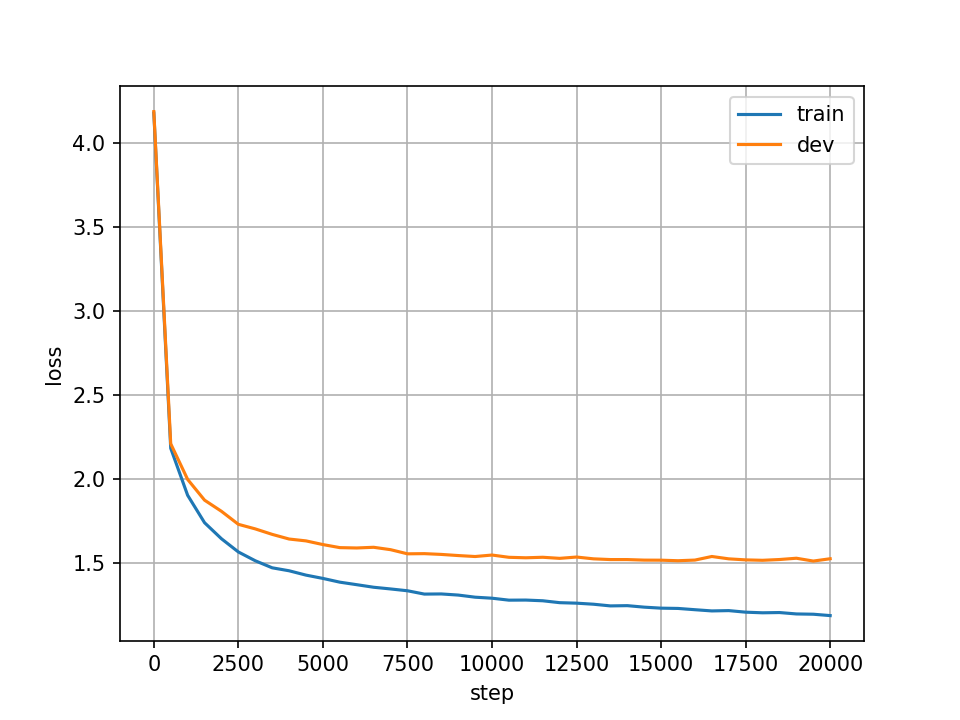

# char-gpt

Character-level, decoder-only transformer implemented in PyTorch without nn.Transformer.

The goal was to create a small GPT-style model by hand to understand and replicate the basic architecture of language models. It was then trained on Shakespeare as a proof-of-concept.

## Description
The model is implemented through multiple classes:
- Data: A shared infrastructure that stores the model's training data and its vocab, and implements some helper functions like splitting datasets for training and validation.
- Modules (Head, MultiHeadAttention, FeedForward, Block): Implementations for the various layers of the model.
- GPT: Decoder-only transformer with a vocab of individual characters. It implements fitting, sampling, custom saving and loading with validation, and a scatter plot of token representations.
- Demo (run_training, run_demo): A small model demo using a Shakespeare dataset.

## Requirements
`pip install torch matplotlib`
- PyTorch
- matplotlib

## Demo
A demo model (1.07M parameters) was trained on a Shakespeare dataset. After 20,000 training steps (11 minutes on a 5070 GPU), it could generate plausible-sounding Shakespeare text.

Sample (cut off after 300 characters):
```
MERCUTIO:
A panting army brother doth not show;
She company my brother loves again.

First Citizen:
Well, he hath got in presently made you beheld his
would I shall be struck in my grave, if she be fear.

MARIANA:
If they have preserved more in your dishonours of courtier,
Which thou weep'st grieved...
```

Run:
- `python transformer.py sample` Samples the model for 300 characters, with 0.8 temperature. The dataset isn't required for sampling.
- `python transformer.py sample "ROMEO:"` Samples text beginning with the argument. If a number is passed; it will sample that amount of characters instead.
- `python transformer.py demo` Reproduces the setup for the sample above with seed 42 (PyTorch version 2.9.1+cu128).
- `python transformer.py train 5000` Retrains a model on the dataset with 5000 steps. Requires downloading the dataset first.

The dataset used is [Tiny Shakespeare](https://raw.githubusercontent.com/karpathy/char-rnn/master/data/tinyshakespeare/input.txt). The text itself is in the public domain.

## Demo - Model
**Architecture**:
- Layers: 6 transformer blocks
- Embedding dimensions: 120
- Attention heads: 6 x 20 dims
- Feed-forward: 120 > 480 > 120, GELU
- Regularization: Dropout 0.05
- Vocabulary: 62 characters (from dataset)
- Positional information: Learned embeddings
- Context: 64
- Optimizer: AdamW (), LR 3e-4, batch size 64
- Total parameters: 1,066,862 (`GPT.size()`)

**Training**:
- The model's final losses were `train: 1.19` and `dev: 1.52`.
- Random guessing would have given a loss of ln(62)=4.127. A newly initialized model gets about 4.2.
- Dev loss plateaus after around 10k training steps, while train loss keeps falling.
- The training is approximately reproducible using seed 42.



## Usage as a library
```python
from transformer import GPT, DEVICE

# Training a model on a dataset
g = GPT('./dataset.txt').to(DEVICE)
g.fit(n=10000, plot=True)
g.estimate_loss(batches=500)
g.save('model.txt', 'vocab.txt')

# Load an existing model
g = GPT('./models/vocab.txt', 'models/transformer-shspr.txt').to(DEVICE)

# Sampling
g.sample(100)
g.sample("ROMEO:", temperature=0.8, top_k=40)
```

## Known limitations
- The model learns spelling, formatting and local word structures but not meaning. This is expected due to its parameter count and 64-character context, which isn't enough to learn sentence-level structure.
- The vocabulary is fixed to the characters encountered in the training dataset.
- The dev data is the last 10% of the dataset, instead of being a random split.
- Basic training: Training uses a constant learning rate, no gradient clipping or early stopping.
- As the model uses 36 separate head modules and no KV cache, it runs slower than it would with concatenated heads and caching.
- Saving and loading model weights uses a custom format which is less efficient than the PyTorch torch.save.

## Next steps
- A longer context and a larger model.
- A subword tokenizer, and an optimized model using already existing libraries.
- A model trained on a larger dataset, such as TinyStories, capable of meaningful output.

## Acknowledgements
The project is inspired by the [Let's build GPT](https://www.youtube.com/watch?v=kCc8FmEb1nY) lecture, then branched off with estimated loss, sampling option, custom saving/loading, different parameters and a complete demo.